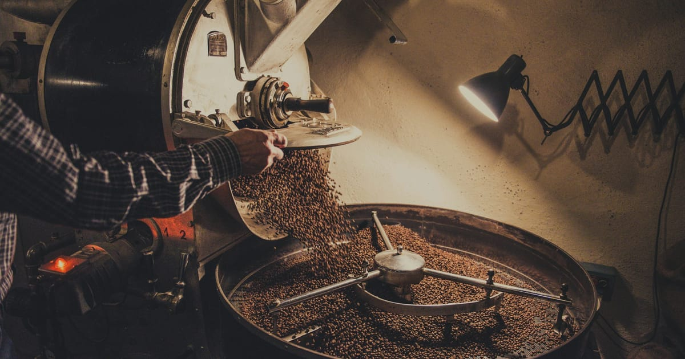

# Ember & Oak — Premium Coffee House Website

**Live site → [emberandoak-coffee.netlify.app](https://emberandoak-coffee.netlify.app)**



A concept website for **Ember & Oak**, a fictional small-batch roastery and café in Brooklyn.
Designed and built as a portfolio piece: editorial typography, a warm ember-and-espresso palette,
and motion that feels slow, deliberate and expensive — like the coffee.

## Highlights

- **Cinematic hero**: full-bleed photo with intro zoom and scroll parallax, word-by-word headline reveal, magnetic CTA buttons
- **Scroll storytelling**: GSAP ScrollTrigger scrubbed text reveal, clip-path image reveals, counter animations, scroll-driven type ticker
- **Interactive menu**: category filter with animated pill and layout transitions, hover-reveal descriptions
- **Bento gallery**: asymmetric grid with in-frame parallax, hover zoom and keyboard-navigable lightbox
- **Reviews marquee**: dual-direction infinite rows that pause on hover
- **Visit us**: live "open now" status and a hand-drawn SVG map with an animated walking route
- **Details**: logo preloader (< 1.5 s), sticky nav that condenses and hides on scroll, animated mobile menu, custom desktop cursor with contextual labels, film-grain overlay, Lenis smooth scrolling

## Quality

- Fully responsive — tuned for 375 px, 768 px and 1440 px
- Respects `prefers-reduced-motion` (no smooth scroll, parallax or marquees)
- Semantic HTML, skip link, alt text, focus states, ARIA on interactive widgets
- Lazy-loaded WebP images (compressed with sharp), responsive `srcset` hero
- Meta tags, Open Graph / Twitter cards, JSON-LD, SVG + PNG favicons
- Vendor code split into cacheable chunks; immutable caching for hashed assets

## Design system

| Token | Hex |
| --- | --- |
| Espresso | `#140E0A` |
| Roast | `#22170F` |
| Cream | `#F2EADC` |
| Oat | `#E4D6BF` |
| Ember | `#D2652D` |
| Brass | `#B8925A` |
| Ash | `#8C7D70` |

Type: **Fraunces** (display serif) + **Manrope** (sans).

## Stack

Vite · React · TypeScript · Tailwind CSS v4 · Framer Motion · GSAP + ScrollTrigger · Lenis · lucide-react

## Run locally

```bash
npm install
npm run dev      # start dev server
npm run build    # type-check + production build
npm run images   # re-download and re-encode photos (sharp)
```

## Credits

All photography from Unsplash under the Unsplash License — see [CREDITS.md](CREDITS.md).
Ember & Oak, its address, menu and reviews are fictional.
